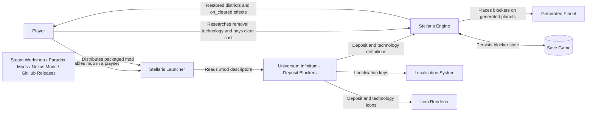
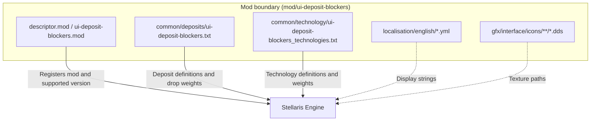
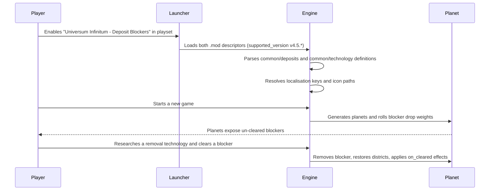
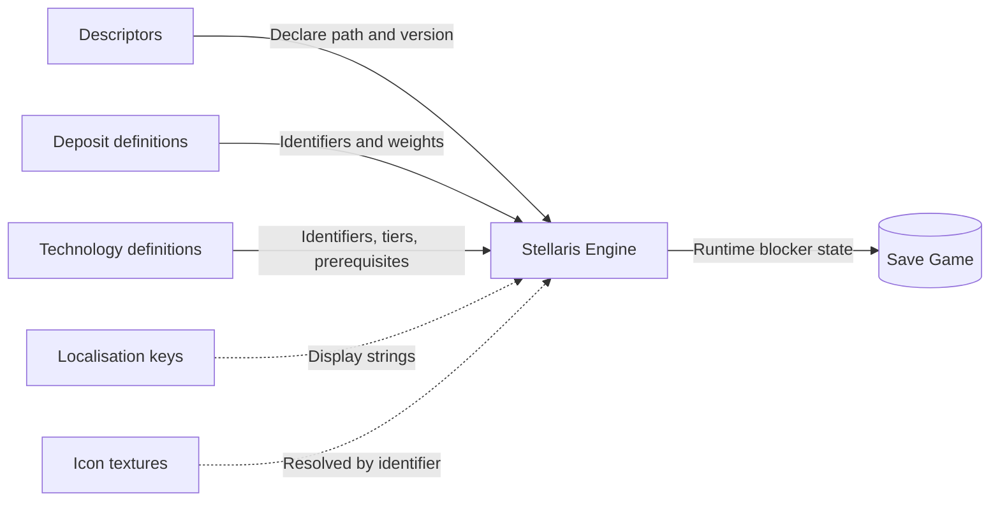
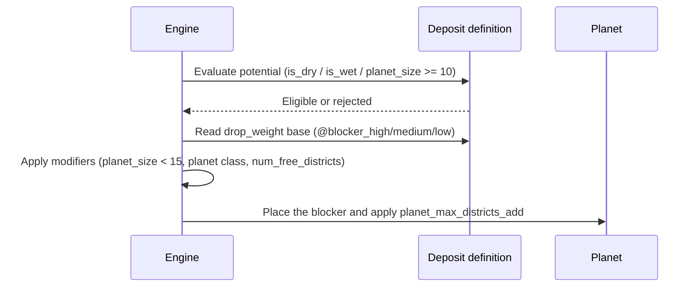
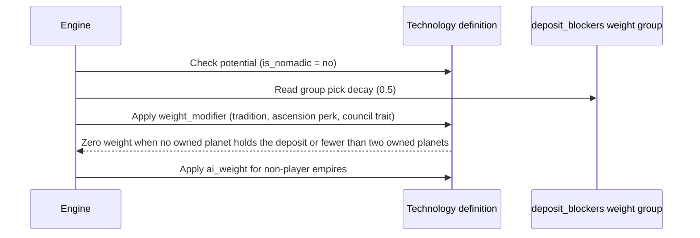
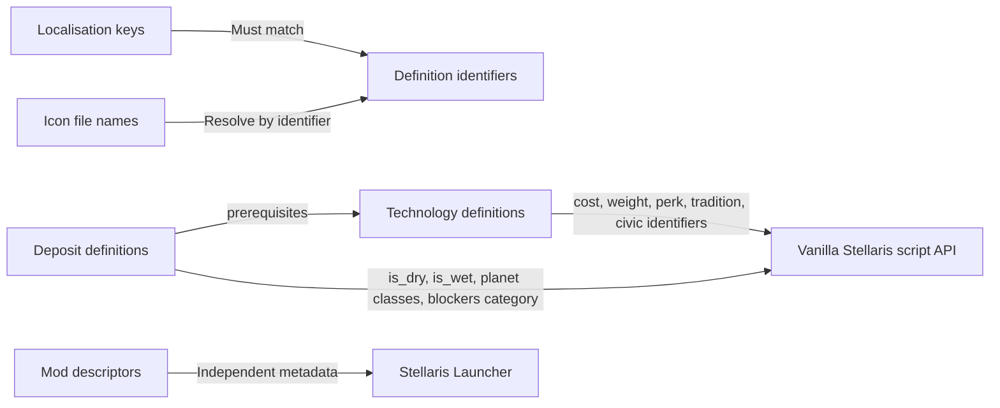

# Universum Infinitum - Deposit Blockers Architecture

This document describes the current architecture of the Stellaris mod Universum Infinitum - Deposit Blockers. It covers the declarative mod boundary that the game engine consumes, the seven planet deposit blockers and their seven removal technologies, the presentation assets and localisation keys bound to those definitions, and the compatibility contracts that keep them consistent. Behaviour implemented by the game engine itself is out of scope.

## 📑 Table of Contents

- [Table of Contents](#-table-of-contents)
- [Purpose](#-purpose)
- [System Context](#-system-context)
- [Architectural Style](#-architectural-style)
- [Runtime Process](#-runtime-process)
- [Components](#-components)
- [Architectural Areas](#-architectural-areas)
  - [Mod Metadata](#mod-metadata)
  - [Deposits](#deposits)
  - [Technologies](#technologies)
  - [Localisation](#localisation)
  - [Interface Assets](#interface-assets)
- [Data Architecture](#-data-architecture)
- [Interfaces and Integrations](#-interfaces-and-integrations)
- [Key Processes](#-key-processes)
  - [Planet Blocker Placement](#planet-blocker-placement)
  - [Technology Availability Arbitration](#technology-availability-arbitration)
  - [Blocker Clearing](#blocker-clearing)
- [Blockers and Technologies Catalogue](#-blockers-and-technologies-catalogue)
- [Cross-Cutting Concerns](#-cross-cutting-concerns)
  - [Error Handling](#error-handling)
  - [Configuration](#configuration)
- [Dependency Direction and Rules](#-dependency-direction-and-rules)
- [External Dependencies](#-external-dependencies)
- [Deployment and Operations](#-deployment-and-operations)
- [Compatibility Contracts](#-compatibility-contracts)
- [Testing and Verification](#-testing-and-verification)
- [Design Constraints](#-design-constraints)
- [Extension Points](#-extension-points)
  - [Adding a Blocker and Its Technology](#adding-a-blocker-and-its-technology)
  - [Adding an Icon or Localisation Entry](#adding-an-icon-or-localisation-entry)
- [Source Map](#-source-map)
- [Related Documentation](#-related-documentation)

## 🎯 Purpose

The mod extends Stellaris planet generation and the society technology tree with seven additional deposit blockers and one removal technology per blocker. Each blocker occupies a planetary region, removes one or two maximum districts, and is gated behind its own tier 1 or tier 2 `new_worlds` technology that must be researched before the blocker can be cleared.

The system responsibility is therefore purely declarative: the repository supplies deposit definitions, technology definitions, English localisation, and icon assets, and the game engine owns parsing, weighted selection, technology arbitration, clearing costs, and persistence. The document is intended for maintainers and contributors who add, tune or repair blocker content, and it records the coupling rules that must hold for the mod to remain loadable and self-consistent.

## 🌐 System Context



The principal external boundaries are:
- **Stellaris Launcher:** Reads `ui-deposit-blockers.mod` and `ui-deposit-blockers/descriptor.mod` to register the mod, its tags, its filesystem path, and its supported game version (`v4.5.*`).
- **Stellaris Engine:** Parses the deposit and technology definitions, performs weighted blocker placement, arbitrates technology availability, enforces prerequisites and clearing costs, and executes `on_cleared` effects.
- **Localisation System:** Resolves the keys declared in `localisation/english/` for blocker names, blocker descriptions, technology names, and technology descriptions.
- **Icon Renderer:** Resolves the deposit and technology icon paths declared under `gfx/interface/icons/` when presenting planets and the technology tree.
- **Save Game:** Owns the persistence of each planet's blocker state; the mod supplies no persistence logic of its own.
- **Distribution Platforms:** Steam Workshop, Paradox Mods, Nexus Mods, and GitHub Releases deliver the packaged mod directory to players.

There is no network, filesystem-write, or untrusted-input boundary inside the mod itself; the repository contains only static text and image assets consumed by the engine.

## 🏗️ Architectural Style

**Declarative data-driven mod (plugin profile).** The repository contains no executable code, no build step, and no runtime entry point. Every file is either a mod descriptor, a script definition parsed by the game engine, a localisation table, or a texture; the single GitHub Actions workflow only republishes a tagged release and executes no mod code. The engine is the sole executor, scheduler, and persistence owner; the mod supplies parameters and assets.



The principal architecture boundaries are:
- **Mod Metadata:** Declares mod identity, tags, filesystem path, and supported game version; the launcher consumes it before any script is parsed.
- **Deposits:** Declares blocker behaviour and weighted placement parameters consumed by planet generation.
- **Technologies:** Declares the removal technologies, their prerequisites, and their availability weights.
- **Localisation:** Maps every definition key to an English display string.
- **Interface Assets:** Supplies the deposit and technology textures referenced by the definitions.

## 🔄 Runtime Process



The principal runtime sequence is:
1. The launcher reads both descriptors and registers the mod for Stellaris `v4.5.*`.
2. The engine parses `common/deposits/ui-deposit-blockers.txt` and `common/technology/ui-deposit-blockers_technologies.txt`, resolving localisation keys and icon paths.
3. During galaxy and planet generation, the engine evaluates each deposit's `potential` block and applies its `drop_weight`, producing blockers on eligible planets.
4. The technology tree offers removal technologies subject to prerequisites, `potential`, `weight`, `weight_modifier`, and the shared `deposit_blockers` weight group.
5. Clearing a blocker consumes the declared resource cost and the scripted clearing time, then applies `planet_modifier` restoration and any `on_cleared` effect.
6. Blocker state is persisted by the engine within the save game; the mod itself performs no persistence or shutdown work.

## 🧩 Components

| Component | Responsibility | Principal Dependencies | Lifetime or Ownership |
|-----------|----------------|------------------------|-----------------------|
| `ui-deposit-blockers.mod` | Root mod descriptor used by the launcher and by distribution packaging | Stellaris launcher mod loader | Static file, owned by the mod author |
| `ui-deposit-blockers/descriptor.mod` | In-directory descriptor mirroring the root descriptor | Stellaris launcher mod loader | Static file, owned by the mod author |
| `common/deposits/ui-deposit-blockers.txt` | Seven `d_ui_*_blocker` deposit definitions, scripted weight variables, placement and clearing behaviour | Stellaris planet generation; technology identifiers | Static script, parsed once per session |
| `common/technology/ui-deposit-blockers_technologies.txt` | Seven `tech_d_ui_*_blocker` society technologies that gate clearing | Stellaris technology system; vanilla technology and tradition identifiers | Static script, parsed once per session |
| `localisation/english/ui-tile-blockers_l_english.yml` | English names and descriptions for the seven blockers | Stellaris localisation system; deposit identifiers | Static table, owned by the mod author |
| `localisation/english/ui-tile-blockers_technologies_l_english.yml` | English names and descriptions for the seven technologies | Stellaris localisation system; technology identifiers | Static table, owned by the mod author |
| `gfx/interface/icons/deposits/*.dds` | Seven deposit icons named after their deposit identifiers | Engine texture loader | Static assets, owned by the mod author |
| `gfx/interface/icons/technologies/*.dds` | Seven technology icons named after their technology identifiers | Engine texture loader | Static assets, owned by the mod author |

## 🗂️ Architectural Areas

### Mod Metadata

Paths:
- `ui-deposit-blockers.mod`
- `ui-deposit-blockers/descriptor.mod`

Responsibilities:
- Declare the mod name, tags (`Galaxy Generation`, `Technologies`), filesystem path (`mod/ui-deposit-blockers`), and supported game version (`v4.5.*`).

Boundary rules:
- Both descriptors are byte-identical and must remain so; either may be read depending on the installation route.
- `path` must resolve to the packaged mod directory for Paradox Mods and manual installation to succeed.
- `supported_version` must be raised in both files together when the mod is updated for a new game version.

### Deposits

Paths:
- `ui-deposit-blockers/common/deposits/ui-deposit-blockers.txt`

Responsibilities:
- Define each `d_ui_*_blocker` deposit, its `potential`, its `drop_weight`, its resource cost, its clearing time, its `planet_modifier`, and its `prerequisites` technology.
- Declare the scripted weight variables `@blocker_high` (10), `@blocker_medium` (7), and `@blocker_low` (5).

Boundary rules:
- Every deposit must reference an existing `tech_d_ui_*_blocker` identifier in `prerequisites`.
- Every deposit must declare `is_for_colonizable = yes` and `category = deposit_cat_blockers`.
- Deposits with `on_cleared` effects must keep those effects limited to engine-safe script; the area owns no persistence.

### Technologies

Paths:
- `ui-deposit-blockers/common/technology/ui-deposit-blockers_technologies.txt`

Responsibilities:
- Define each `tech_d_ui_*_blocker` technology with `area = society`, tier, `category = { new_worlds }`, `prerequisites = { "tech_colonization_1" }`, vanilla-sourced cost and weight variables, `weight_modifier`, and `ai_weight`.
- Bind every technology to the shared `deposit_blockers` weight group.

Boundary rules:
- Every technology identifier must have exactly one matching deposit identifier and one localisation entry.
- Technology tier, cost variable, and weight variable must stay aligned (`@tier1cost2`/`@tier1weight2` for tier 1, `@tier2cost2`/`@tier2weight2` for tier 2).
- The shared weight group constant `deposit_blockers = 0.5` must remain consistent across all seven definitions so that availability competition stays balanced.

### Localisation

Paths:
- `ui-deposit-blockers/localisation/english/ui-tile-blockers_l_english.yml`
- `ui-deposit-blockers/localisation/english/ui-tile-blockers_technologies_l_english.yml`

Responsibilities:
- Provide one display name and one `_desc` entry per blocker and per technology under `l_english`.

Boundary rules:
- Key spelling must match the identifiers in the deposit and technology definitions exactly, including the `_desc` suffix.
- Only `l_english` is present; any added locale is a new area, not a modification of these files.

### Interface Assets

Paths:
- `ui-deposit-blockers/gfx/interface/icons/deposits/`
- `ui-deposit-blockers/gfx/interface/icons/technologies/`

Responsibilities:
- Supply one `.dds` texture per deposit and per technology, named after the corresponding identifier.

Boundary rules:
- File names must equal the definition identifiers exactly (`d_ui_*_blocker.dds`, `tech_d_ui_*_blocker.dds`); the engine resolves icons by convention rather than by an explicit path declaration.

## 💾 Data Architecture

The mod owns definitional data only. All runtime state — which planets hold which blockers and which blockers have been cleared — is owned and persisted by the game engine.



| Data or Store | Owner | Representation and Storage | Lifecycle or Consistency |
|---------------|-------|----------------------------|--------------------------|
| `d_ui_*_blocker` deposit definition | Mod author; `common/deposits/ui-deposit-blockers.txt` | Script block with `potential`, `drop_weight`, `resources`, `time`, `planet_modifier`, `prerequisites` | Created with the file; consumed at parse time; changes require a new game to affect generated planets |
| `tech_d_ui_*_blocker` technology definition | Mod author; `common/technology/ui-deposit-blockers_technologies.txt` | Society technology block with tier, cost and weight variables, and availability modifiers | Created with the file; arbitrated per technology rollout; changes affect new rolls |
| Scripted weight variables `@blocker_high`, `@blocker_medium`, `@blocker_low` | Mod author; deposits file header | Numeric scripted variables (10, 7, 5) referenced by every `drop_weight` | Evaluated at parse time; a single edit changes every referring deposit |
| Localisation keys | Mod author; `localisation/english/*.yml` | `l_english` key-value table | Resolved at display time; a missing key surfaces as a raw key in game |
| Icon textures | Mod author; `gfx/interface/icons/` | `.dds` textures named after definition identifiers | Resolved by naming convention at display time |
| Mod descriptors | Mod author; repository root and mod directory | Key-value `.mod` metadata | Read once at launcher startup |
| Blocker runtime state | Game engine | Save-game state | Created during planet generation; mutated on clearing; never written by the mod |

## 🔌 Interfaces and Integrations

| Interface or Integration | Direction | Contract | Owner | Failure Semantics |
|--------------------------|-----------|----------|-------|-------------------|
| Mod descriptor contract | Inbound | `.mod` metadata keys `name`, `path`, `tags`, `supported_version="v4.5.*"` | Launcher, consumed by both descriptors | Invalid path or unsupported version prevents the mod from loading; the launcher surfaces the rejection |
| Deposit definition API | Inbound | Deposit block names `d_ui_*_blocker` with `potential`, `drop_weight`, `resources`, `time`, `planet_modifier`, `prerequisites` | Stellaris planet generation | Parse errors reject the block, so the blocker never generates |
| Technology definition API | Inbound | Technology block names `tech_d_ui_*_blocker` with `area`, `tier`, `category`, `prerequisites`, `weight`, `weight_modifier`, `ai_weight` | Stellaris technology system | Parse errors or unsatisfiable prerequisites make the technology permanently unavailable |
| Localisation interface | Inbound | `l_english` keys `d_ui_*_blocker`, `d_ui_*_blocker_desc`, `tech_d_ui_*_blocker`, `tech_d_ui_*_blocker_desc` | Stellaris localisation system | Missing keys render raw identifiers instead of readable text |
| Icon resolution interface | Inbound | Texture file names equal to definition identifiers under `gfx/interface/icons/deposits/` and `gfx/interface/icons/technologies/` | Engine texture loader | Missing textures render placeholder or blank icons |
| Distribution channels | Outbound | Steam Workshop item, Paradox Mods listing, Nexus Mods listing, and GitHub Releases archive containing the mod directory | Author-published; verified by the README installation routes | A stale package delivers outdated definitions while the repository already contains newer content |

## 🔀 Key Processes

### Planet Blocker Placement



Placement is owned entirely by the engine. The mod supplies the `potential` gate, the base weight, and the multiplicative modifiers. A weight of `0` is applied when the planet has fewer than two free city districts, preventing blockers from making planets uncolonisable. Five blockers declare `all_blocker_swap_types = yes`, so the engine may substitute vanilla-compatible blocker types when a planet's class does not support the compact form.

### Technology Availability Arbitration



All seven technologies share the `deposit_blockers` weight group with a pick decay of `0.5`, which spreads research across the family instead of favouring a single blocker. Each technology is suppressed while no owned planet carries its deposit and while the empire owns fewer than two planets, so the family does not compete with early colonisation.

### Blocker Clearing

```mermaid
sequenceDiagram
    participant Player
    participant Engine
    participant Deposit as Deposit definition
    Player->>Engine: Attempt to clear a blocker
    Engine->>Deposit: Verify prerequisite technology is researched
    Engine->>Engine: Consume resources cost and time
    Engine->>Deposit: Restore planet_max_districts_add and run on_cleared
    Deposit-->>Player: Districts restored; hive devouring swarm receives food where declared
```

Clearing requires both the technology gate and the resource cost declared in the deposit. Two blockers (`d_ui_giant_earthworms_blocker` and `d_ui_sea_monsters_blocker`) additionally grant `food = 200` through a hidden `on_cleared` effect when the owner has `civic_hive_devouring_swarm`; the remaining five blockers have no clearing effect beyond district restoration.

## ⚙️ Blockers and Technologies Catalogue

| Blocker | Placement potential | Technology tier | Clearing cost | Clearing time | District effect | Drop weight | Swap types |
|---------|--------------------|-----------------|---------------|---------------|-----------------|-------------|------------|
| `d_ui_ashland_blocker` | `is_dry = yes` | 1 | 1000 energy | 270 | -1 | `@blocker_medium` (7) | Yes |
| `d_ui_canyon_blocker` | `is_dry = yes` | 1 | 1000 energy | 270 | -1 | `@blocker_high` (10) | Yes |
| `d_ui_floodplain_blocker` | `is_wet = yes` | 1 | 500 energy | 180 | -1 | `@blocker_high` (10) | Yes |
| `d_ui_giant_earthworms_blocker` | `is_dry = yes` and `planet_size >= 10` | 2 | 500 energy | 270 | -2 | `@blocker_low` (5) | No |
| `d_ui_lava_lake_blocker` | `is_dry = yes` | 2 | 500 energy | 180 | -1 | `@blocker_medium` (7) | Yes |
| `d_ui_sea_monsters_blocker` | `is_wet = yes` and `planet_size >= 10` | 2 | 500 energy | 270 | -2 | `@blocker_low` (5) | No |
| `d_ui_tarland_blocker` | `is_dry = yes` | 1 | 750 energy, 250 minerals | 270 | -1 | `@blocker_medium` (7) | Yes |

Each row corresponds to one deposit block in `common/deposits/ui-deposit-blockers.txt` and one technology block in `common/technology/ui-deposit-blockers_technologies.txt`. Both files must be edited together when a blocker is added, retuned, or removed.

## 🧵 Cross-Cutting Concerns

### Error Handling

Failures originate in the engine's script parser and in the localisation and asset resolvers, not in mod-owned code. A malformed or misplaced block causes the engine to reject that block, which silently removes the blocker or the technology from play; a mismatched localisation key renders the raw identifier; a missing texture renders a blank icon. The mod therefore treats the consistency checks documented under Testing and Verification as its error-detection strategy, because there is no runtime surface the mod can instrument.

### Configuration

| Configuration Area | Source | Responsibility | Supersede or Secret Policy |
|--------------------|--------|----------------|---------------------------|
| Mod identity and packaging | `ui-deposit-blockers.mod`, `ui-deposit-blockers/descriptor.mod` | Name, tags, filesystem path, and supported game version presented to the launcher | Duplicated deliberately; both files are identical and no secret is involved |
| Blocker placement tuning | Scripted variables `@blocker_high`, `@blocker_medium`, `@blocker_low` in `common/deposits/ui-deposit-blockers.txt` | Common drop-weight baselines for every deposit | Defined once at the top of the file and consumed by all deposits |
| Technology cost and weight | Vanilla scripted variables `@tier1cost2`, `@tier1weight2`, `@tier2cost2`, `@tier2weight2` | Technology cost and selection weight | Resolved from the base game, so values change with the game version |
| Availability competition | Vanilla technology weight group `deposit_blockers` with decay `0.5` | Spreads research across the blocker family | Declared per technology; must stay consistent across all seven |

No credentials, endpoints, or personal data exist in this configuration surface.

## 🧭 Dependency Direction and Rules

Content in this repository depends only on engine-provided script APIs, vanilla scripted variables, and vanilla identifiers. No file depends on another file's implementation, but all definition files are coupled through shared identifiers.



The principal dependency rules are:
- Deposit-to-technology references are one-way: deposits name their prerequisite technology, and technologies never reference deposits.
- Localisation keys and icon file names depend on definition identifiers and must be updated whenever an identifier changes.
- Everything depends on vanilla identifiers such as `tech_colonization_1`, `new_worlds`, `tr_expansion_adopt`, `ap_mastery_of_nature`, `civic_hive_devouring_swarm`, and `leader_trait_expertise_new_worlds`; these are external contracts that may change between game versions.
- No file may introduce a dependency on another mod; the mod remains standalone and load-order independent.
- The two descriptors must not diverge from each other.

## 📦 External Dependencies

| Dependency | Responsibility | Integration Boundary | Architectural Consequence |
|------------|----------------|----------------------|---------------------------|
| Stellaris `v4.5.*` engine | Parses deposit and technology scripts, performs placement, arbitration, clearing, and persistence | Mod descriptor `supported_version`; script API | Any game update that changes the script API or vanilla identifiers invalidates the mod until re-verified |
| Vanilla scripted variables `@tier1cost2`, `@tier1weight2`, `@tier2cost2`, `@tier2weight2` | Supply technology cost and selection weight | Technology definitions | Technology balance moves with the base game and cannot be tuned independently without overriding the variables |
| Vanilla technology `tech_colonization_1` | Prerequisite for every blocker removal technology | `prerequisites` in each technology block | Blockers cannot be cleared before the vanilla colonisation technology is researched |
| Vanilla technology category `new_worlds` | Places the technologies in the society tree alongside colonisation content | `category` in each technology block | Category changes in the base game relocate the whole family |
| Vanilla tradition `tr_expansion_adopt` and ascension perk `ap_mastery_of_nature` | Modify removal technology selection weight (`1.25` and `4`) | `weight_modifier` blocks | Balance multipliers must be re-checked when these vanilla entries change |
| Vanilla civic `civic_hive_devouring_swarm` | Gates the `on_cleared` food grant on two blockers | `on_cleared` blocks | Civic renames or removals break the conditional effect |
| Vanilla leader trait `leader_trait_expertise_new_worlds` | Applies a `1.25` weight multiplier in player and AI weights | `weight_modifier` and `ai_weight` blocks | Trait identifier changes silently remove the multiplier |
| Icon and badge asset repositories | README distribution badges only; not consumed by the mod at runtime | README rendering | No runtime consequence |

## 🚀 Deployment and Operations

The deployment unit is the packaged mod directory `mod/ui-deposit-blockers` together with the matching `.mod` descriptor. There is no process, service, port, or network requirement: the game engine loads the directory in-process.

| Concern | Current Design | Architectural Consequence |
|---------|----------------|---------------------------|
| Process topology | No mod-owned process; everything runs inside the game client | No startup, shutdown, health, or scaling responsibility belongs to the mod |
| Persistent state | None owned by the mod; the engine persists blocker state in the save game | Removing or renaming a blocker mid-campaign can leave saved references the engine must resolve |
| Distribution | Steam Workshop, Paradox Mods, Nexus Mods, and GitHub Releases | Each channel receives a packaged snapshot; outdated snapshots deliver outdated definitions |
| Publication automation | `.github/workflows/nexus-mods-release.yml` uploads the tagged GitHub release archive to Nexus Mods | Nexus Mods tracks tags automatically; the other three channels still depend on manual uploads |
| Version gate | `supported_version="v4.5.*"` in both descriptors | A game update outside that range prevents loading until the version is raised |
| Installation | Extract the release contents into the game's mod directory, or subscribe through a store | Manual installs can drift from the published release |
| Availability | Single-player and multiplayer mod-dependent sessions | Clients with mismatched versions fail the multiplayer checksum comparison |
| Section content | No secret, credential, or private endpoint is required for operation | Operators perform no secret provisioning |

## 🛡️ Compatibility Contracts

| Contract | Owner | Invariant | Verification | Change Policy |
|----------|-------|-----------|--------------|---------------|
| Descriptor parity | `ui-deposit-blockers.mod`, `ui-deposit-blockers/descriptor.mod` | Both files remain byte-identical in name, path, tags, and supported version | `diff` of the two files | Any descriptor edit must be applied to both files in the same change |
| Identifier coupling | Deposit, technology, localisation, and icon definitions | Each `d_ui_*_blocker` has a matching `tech_d_ui_*_blocker`, two localisation keys (`name` and `_desc`), and two icon files | Identifier cross-check commands in Testing and Verification | Renames must update all five surfaces atomically |
| Prerequisite link | `common/deposits/ui-deposit-blockers.txt` | Every deposit's `prerequisites` names an existing technology in this mod | Prerequisite cross-check command | A deposit must never name a technology that does not exist |
| Localisation suffix | `localisation/english/*.yml` | Each identifier has a `_desc` companion key, and technology descriptions include the trailing newline encoding used by the existing entries | Key count and suffix inspection | New entries follow the existing `:0` / `:1` versioning convention |
| Weight baseline semantics | `common/deposits/ui-deposit-blockers.txt` header | `@blocker_high` = 10, `@blocker_medium` = 7, `@blocker_low` = 5 | Inspection of the header and `drop_weight` references | Changing a baseline retunes every referring deposit at once |
| Shared technology weight group | `common/technology/ui-deposit-blockers_technologies.txt` | All seven technologies declare `weight_groups = { deposit_blockers }` with `mod_weight_if_group_picked = 0.5` | Weight group cross-check | Any change must be applied to all seven blocks to preserve competition balance |
| Icon naming convention | `gfx/interface/icons/` | Texture file names equal definition identifiers | Icon existence cross-check command | Assets must be renamed together with their identifiers |
| Vanilla identifier usage | Technology and deposit definitions | Vanilla identifiers referenced by the mod exist in the target game version | In-game load and play-through verification | Vanilla rename or removal is a breaking change requiring a mod revision |

## ✅ Testing and Verification

The repository contains no automated test suite, test project, lint configuration, or validation workflow; the only workflow publishes tagged releases to Nexus Mods. Verification is achieved through identifier cross-checks and in-game observation. The engine is the only authority on whether the scripts parse and behave as intended, so the checks below concentrate on the coupling rules that the engine cannot report clearly.

Execute the principal automated verification with:

```bash
for t in $(grep -o '^tech_d_ui_[a-z_]*_blocker' ui-deposit-blockers/common/technology/ui-deposit-blockers_technologies.txt); do grep -q "prerequisites = { \"$t\" }" ui-deposit-blockers/common/deposits/ui-deposit-blockers.txt || echo "unlinked: $t"; done
```

A clean run prints nothing; any `unlinked:` line identifies a technology that no deposit references as a prerequisite.

Execute the asset presence verification with:

```bash
for d in $(grep -o '^d_ui_[a-z_]*_blocker' ui-deposit-blockers/common/deposits/ui-deposit-blockers.txt); do test -f "ui-deposit-blockers/gfx/interface/icons/deposits/$d.dds" || echo "missing icon: $d"; done
```

A clean run prints nothing; any `missing icon:` line identifies a deposit whose icon file name does not match its identifier.

Manual verification covers the behaviour the checks cannot prove:
- Load the mod in the launcher and confirm both descriptors are accepted for `v4.5.*`.
- Start a new game and confirm each blocker appears with a readable localised name and a rendered icon on eligible planets.
- Confirm each removal technology appears in the society tree under `new_worlds` at the expected tier and is suppressed while no owned planet holds its deposit.
- Research one tier 1 and one tier 2 technology, clear the corresponding blocker, and confirm the resource cost, the clearing time, the district restoration, and the devouring swarm food grant on the two blockers that declare it.
- Confirm no script error is reported by the game log during load and during a clearing action.

Material coverage gaps:
- No automated validation exists for descriptor parity, localisation key completeness, or texture file validity.
- Multiplayer checksum parity and save-game migration after removing a blocker are not systematically verified.
- Balance outcomes (drop frequency and technology selection rate) are not measured; they can only be observed in play.

## ⚠️ Design Constraints

- **Engine-owned execution:** All behaviour is the engine's; the mod can only declare parameters. Any behaviour the script API does not expose cannot be implemented here.
- **No build or test toolchain:** There is no compilation, linting, or packaging command in the repository, so contributor verification relies on cross-check commands and in-game observation. The sole workflow, `.github/workflows/nexus-mods-release.yml`, only publishes a tagged release to Nexus Mods.
- **Deliberate descriptor duplication:** The metadata exists twice and must be edited twice; the duplication is a distribution requirement rather than an oversight.
- **Five-way identifier coupling:** Deposit identifier, technology identifier, two localisation keys, and two icon names must agree; the engine reports mismatches only indirectly.
- **Scripted clearing time is fixed per blocker:** Clearing time is a static value (180 or 270) with no modifier hooks in the current definitions.
- **Single locale:** Only `l_english` exists; other locales display the English strings or raw keys.
- **Weight competition within one group:** All seven technologies share the `deposit_blockers` group, so adding more members lowers each existing member's selection share unless the decay constant is revisited.
- **Observed asymmetry requiring care:** Only `d_ui_ashland_blocker` declares `category = deposit_blockers` inside its `resources` block, while the other six deposits omit it. This is recorded as an observed inconsistency and a verification gap rather than a confirmed defect, because the effect of the omission is determined by the engine and has not been measured.
- **No version pin beyond the major range:** `supported_version="v4.5.*"` permits any 4.5 patch, so a patch that changes referenced vanilla identifiers would load but misbehave.

## 🔧 Extension Points

### Adding a Blocker and Its Technology

1. Add the `d_ui_<name>_blocker` block to `ui-deposit-blockers/common/deposits/ui-deposit-blockers.txt`, including `potential`, `drop_weight`, `resources`, `time`, `planet_modifier`, and a `prerequisites` entry naming the new technology.
2. Add the matching `tech_d_ui_<name>_blocker` block to `ui-deposit-blockers/common/technology/ui-deposit-blockers_technologies.txt`, keeping `area = society`, a tier with its aligned cost and weight variables, `category = { new_worlds }`, the `deposit_blockers` weight group, and the same weight modifiers used by the existing family.
3. Add the four localisation keys and both icon textures named exactly after the two identifiers.
4. Re-run the prerequisite and icon cross-checks, then verify placement, arbitration, and clearing in game.

The extension must preserve the identifier coupling, the tier-to-variable alignment, and the shared weight group constant; alpha-numeric ordering of blocks within each file is the existing convention.

### Adding an Icon or Localisation Entry

1. Create the asset or key using the exact identifier of the deposit or technology it represents.
2. Place deposit icons under `ui-deposit-blockers/gfx/interface/icons/deposits/` and technology icons under `ui-deposit-blockers/gfx/interface/icons/technologies/`, or add the key to the appropriate `localisation/english/` file.
3. Re-run the asset cross-check and confirm the in-game rendering.

Asset and key names must never be shortened or abbreviated relative to the identifier, because resolution depends on exact name equality.

## 🗺️ Source Map

| Area | Path |
|------|------|
| Mod metadata | `ui-deposit-blockers.mod`, `ui-deposit-blockers/descriptor.mod` |
| Deposits | `ui-deposit-blockers/common/deposits/` |
| Technologies | `ui-deposit-blockers/common/technology/` |
| Localisation | `ui-deposit-blockers/localisation/english/` |
| Interface assets | `ui-deposit-blockers/gfx/interface/icons/deposits/`, `ui-deposit-blockers/gfx/interface/icons/technologies/` |
| Distribution metadata | `.github/FUNDING.yml`, `.github/ui_cover.png`, `ui-deposit-blockers/thumbnail.png` |

## 📚 Related Documentation

- [README.md](./README.md) documents the player-facing description, installation routes, compatibility statement, and contribution channels of the mod.
- [LICENSE](./LICENSE) contains the GNU General Public License version 3 under which the project is distributed.
