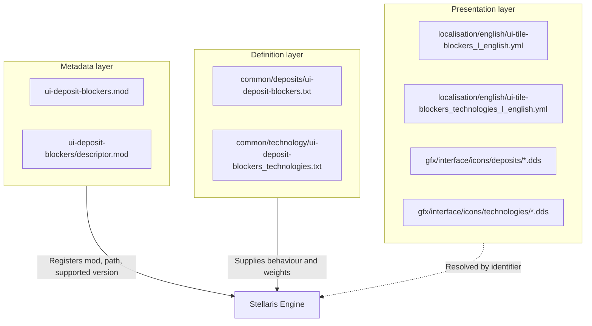
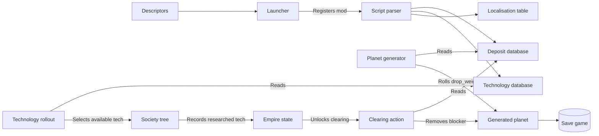
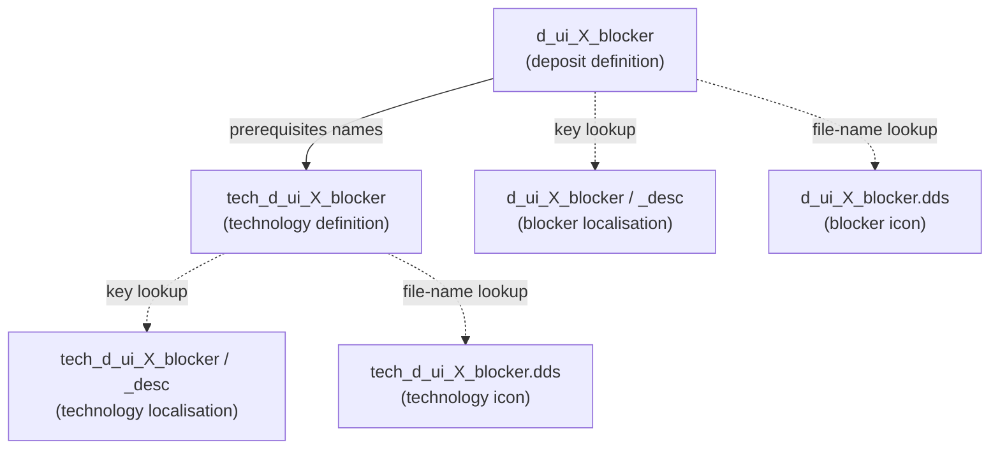

# Architecture

> The root [`ARCHITECTURE.md`](../ARCHITECTURE.md) defines the system context, component catalogue, architectural areas, key processes, compatibility contracts, and design constraints for this mod. This document complements it by explaining the **engine integration model** in more depth: what the engine does with each declaration, which of its subsystems consume which file, and where the mod's influence ends.

## Architectural classification

The mod is a **declarative data-driven plug-in**. The applicable profile from a plugin perspective is:

| Dimension | Value | Evidence |
|-----------|-------|----------|
| Executable code | None | Only `.txt`, `.yml`, `.mod`, `.dds`, `.png` files |
| Build step | None | No build files and no scripts; the workflows (`.github/workflows/github-release.yml`, `.github/workflows/nexus-mods-release.yml`, `.github/workflows/steam-workshop-release.yml`) package the content at publish time without compiling |
| Runtime entry point | None owned by the mod | The launcher and engine own loading |
| State ownership | None | No persistence code; save game holds blocker state |
| Extension mechanism | Engine file-format conventions | Fixed directory names under `common/`, `gfx/`, `localisation/` |

## Three-layer composition

Each layer is independent in parse order but coupled by identifier:

- Layer 1 is read before anything else and can prevent the mod from loading entirely.
- Layer 2 is parsed once per session; failures here are per-block.
- Layer 3 is resolved lazily at display time; failures here are cosmetic or text-level.

## Engine subsystems and their contracts

| Engine subsystem | Consumes | Contract | Mod-side obligation |
|------------------|----------|----------|---------------------|
| Launcher mod loader | Both `.mod` descriptors | `name`, `path`, `tags`, `supported_version` | Both descriptors must be identical and the version must match the installed game |
| Planet generation | Deposit `potential`, `drop_weight`, `resources`, `time`, `planet_modifier` | Field names and vanilla predicate identifiers | Predicates must exist in the target version |
| Blocked-deposit clearing | Deposit `prerequisites`, `resources`, `time`, `planet_modifier`, `on_cleared` | Prerequisite must resolve; costs must be payable | Prerequisite identifier must match a defined technology |
| Technology tree | Technology `cost`, `area`, `tier`, `category`, `prerequisites`, `weight`, `potential` | Vanilla variables and category must exist | `category = { new_worlds }` must exist in the target version |
| Technology weighting | `weight_groups`, `mod_weight_if_group_picked`, `weight_modifier`, `ai_weight` | Group names are global across mods | The `deposit_blockers` group is mod-defined; no vanilla collision was found, but collisions are not verified |
| Localisation | `l_english` table | Key must equal identifier; `_desc` suffix for descriptions | Keys must track identifier renames |
| Texture resolution | File names in `gfx/interface/icons/` | Name equals definition identifier | Assets must be renamed with their identifiers |

## Data flow through the engine

Two important properties follow:

1. **Blocker placement is decided at planet-generation time.** Changing a `potential` or `drop_weight` affects only planets generated afterwards.
2. **Technology availability is decided at each research rollout.** Changing a `weight_modifier` affects subsequent rollouts in existing campaigns.

## The identifier coupling lattice

Every blocker is a single logical unit expressed in five places:

The engine resolves the dotted links implicitly. A missing key or missing texture does not raise a script error into the mod's control; it renders a raw key or a blank icon. This is why [`invariants.md`](invariants.md) records the coupling and [`testing.md`](testing.md) provides cross-check commands.

## Why there is no layering between deposits and technologies

The dependency is deliberately one-directional: deposits name technologies, technologies never name deposits. This makes it impossible to express "this technology requires that blocker" and removes the risk of circular resolution during parsing. The trade-off is that a deposit cannot vary its own technology reference conditionally; the reference is static.

## Influence boundary

| The mod can change | The mod cannot change |
|--------------------|-----------------------|
| Whether a blocker can appear at all (`potential`) | How the engine iterates candidate blockers |
| How likely a blocker is relative to others (`drop_weight`, scripted baselines) | Whether a planet is generated at all |
| What a blocker costs to clear (`resources`, `time`) | Whether a player can afford it |
| What clearing restores (`planet_modifier`, `on_cleared`) | The order in which engine effects apply |
| When the removal technology becomes available (`weight`, `weight_modifier`, `potential`) | Whether the technology ever rolls for a given empire |
| Displayed text and icons | Layout, tooltips, and presentation structure |

## Where to go next

- Exact schema: [`api-reference/INDEX.md`](api-reference/INDEX.md)
- Execution sequences: [`flows/startup-and-loading.md`](flows/startup-and-loading.md)
- Recorded trade-offs: [`design-decisions.md`](design-decisions.md)
