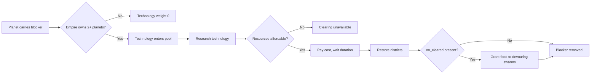

# Research and clearing behaviour

## Summary

Each blocker has one dedicated removal technology. Until that technology is researched the blocker is permanent; afterwards the player may pay the declared cost and wait the declared duration to remove it and recover the lost districts.

## Research behaviour

| Observation | Cause |
|-------------|-------|
| The technology is absent from the research options | `potential = { is_nomadic = no }` excluded the empire, or the weight is zero |
| The technology appears abruptly mid-campaign | The empire reached two owned planets and acquired a planet carrying the matching blocker |
| The technology disappears again | The last planet carrying the blocker was lost or the empire dropped below two planets |
| The technology appears more often after taking Nature Mastery | `ap_mastery_of_nature` multiplies weight by 4 |
| The technology appears more often after adopting the expansion tradition | `tr_expansion_adopt` multiplies weight by 1.25 |
| A `new_worlds`-specialised council member raises the chance | `leader_trait_expertise_new_worlds` multiplies weight by 1.25 |
| Subsequent family technologies are slower to appear | `mod_weight_if_group_picked = 0.5` halves the weight of the remaining members |

### Tier progression

| Tier | Technologies | Relative research cost |
|------|--------------|------------------------|
| 1 | Ashland, Canyon, Floodplain, Tarland | `@tier1cost2` |
| 2 | Giant Earthworms, Lava Lake, Sea Monsters | `@tier2cost2` |

Tier 2 is reached after the vanilla `tech_colonization_1` prerequisite is met, and its cost corresponds to the base game's tier 2 society economy.

## Clearing behaviour

| Observation | Cause |
|-------------|-------|
| Clearing is offered but greyed out | The technology is unresearched or the resources are unaffordable |
| Clearing takes a long time | `time = 270` blockers; the `180` blockers resolve faster |
| Clearing needs minerals as well as energy | Tarland is the only blocker with a mineral component |
| Clearing one district returns | The blocker was a `-1` blocker |
| Clearing two districts returns | The blocker was a `-2` blocker |
| Food is silently granted | The owner is a devouring swarm and the blocker was Giant Earthworms or Sea Monsters |
| No food is granted despite clearing Giant Earthworms | The owner lacks `civic_hive_devouring_swarm` |

### Distribution of clearing characteristics

| Characteristic | Values | Count |
|----------------|--------|-------|
| Duration | 180 days | 2 blockers (Floodplain, Lava Lake) |
| Duration | 270 days | 5 blockers |
| Energy cost | 500 | 4 blockers |
| Energy cost | 750 + 250 minerals | 1 blocker (Tarland) |
| Energy cost | 1000 | 2 blockers (Ashland, Canyon) |
| District restoration | 1 | 5 blockers |
| District restoration | 2 | 2 blockers |
| Food grant on clearing | 200 food for devouring swarms | 2 blockers |

## Interplay between research and clearing

The two halves are independent: research availability depends on the empire's planet holdings, while clearing depends on the researched technology plus affordability. A player can therefore hold a blocker for an entire campaign simply because the technology never rolled.

## Practical consequences for players

| Situation | Effect |
|-----------|--------|
| Single-planet start with a blocker | The technology cannot appear until a second planet is owned |
| Small empire with a blocker | The technology may appear late, delaying district recovery |
| Wide empire with many blockers | Multiple family technologies compete, and the group decay spreads research across them |
| Nature-mastery or expansion builds | Thematically rewarded with faster access to the removal technologies |
| Nomadic empire | Never receives the removal technologies; the blockers are effectively permanent |
| Devouring swarm | Gains `food = 200` from clearing the two organic blockers |

## Where to go next

- Placement behaviour: [`blocker-appearance.md`](blocker-appearance.md)
- Clearing mechanics: [`../flows/technology-research-and-blocker-clearing.md`](../flows/technology-research-and-blocker-clearing.md)
- Technology weights: [`../configuration.md`](../configuration.md)
