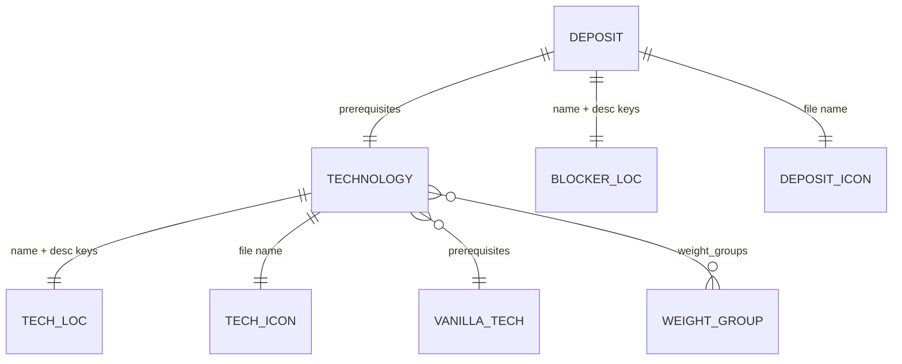

# Data model

## Entities

The mod defines two entity types and references one vanilla entity type.

| Entity | Identifier pattern | Defined in | Cardinality |
|--------|-------------------|------------|-------------|
| Deposit (blocker) | `d_ui_<name>_blocker` | `common/deposits/ui-deposit-blockers.txt` | 7 |
| Removal technology | `tech_d_ui_<name>_blocker` | `common/technology/ui-deposit-blockers_technologies.txt` | 7 |
| Localisation entry | `<identifier>` and `<identifier>_desc` | `localisation/english/*.yml` | 14 keys per file group |
| Texture | `<identifier>.dds` | `gfx/interface/icons/{deposits,technologies}/` | 14 files |
| Vanilla colonisation technology | `tech_colonization_1` | Base game | Referenced by all 7 technologies |

## Relationship model

| Relationship | Direction | Cardinality | Enforced by |
|--------------|-----------|-------------|-------------|
| Deposit → technology | One-way, mandatory | Exactly one technology per deposit | Script semantics; not validated by the engine at parse time |
| Technology → vanilla colonisation | One-way, mandatory | All seven reference `tech_colonization_1` | Vanilla identifier must exist |
| Technology → weight group | Many-to-one | All seven share `deposit_blockers` | Mod convention |
| Definition → localisation | Implicit | One name key and one `_desc` key | Display-time resolution |
| Definition → texture | Implicit | Exactly one file per identifier | File-name resolution |

## Field summary: deposit

| Field | Type | Values used | Meaning |
|-------|------|-------------|---------|
| `time` | Integer | `180`, `270` | Clearing days |
| `is_for_colonizable` | Boolean | `yes` | Blocker can appear on colonisable planets |
| `category` | Identifier | `deposit_cat_blockers` | Places the deposit in the vanilla blocker category |
| `resources.category` | Identifier | `deposit_blockers` (present on Ashland only — see [ambiguities](ambiguities-and-open-questions.md)) | Resource category of the cost |
| `resources.cost.energy` | Integer | `500`, `750`, `1000` | Energy cost of clearing |
| `resources.cost.minerals` | Integer | `250` (Tarland only) | Mineral cost of clearing |
| `potential` | Condition block | `is_dry`, `is_wet`, `planet_size >= 10` | Gate on planet eligibility |
| `planet_modifier.planet_max_districts_add` | Integer | `-1`, `-2` | Maximum districts removed while blocked |
| `all_blocker_swap_types` | Boolean | `yes` on five blockers | Permits engine substitution of equivalent blocker types |
| `on_cleared` | Effect block | Present on two blockers | Hidden effect granting food to devouring swarms |
| `drop_weight.weight` | Scripted variable | `@blocker_high`, `@blocker_medium`, `@blocker_low` | Base placement weight |
| `drop_weight.modifier[]` | Condition/factor pairs | See [`api-reference/deposit-definition-schema.md`](api-reference/deposit-definition-schema.md) | Multiplicative placement adjustments |
| `prerequisites` | Identifier list | `tech_d_ui_<name>_blocker` | Technology required to clear |

## Field summary: technology

| Field | Type | Values used | Meaning |
|-------|------|-------------|---------|
| `cost` | Scripted variable | `@tier1cost2`, `@tier2cost2` | Research cost |
| `area` | Identifier | `society` | Research area |
| `tier` | Integer | `1`, `2` | Tree tier |
| `category` | Identifier set | `{ new_worlds }` | Tree category |
| `prerequisites` | Identifier list | `tech_colonization_1` | Vanilla gate |
| `weight` | Scripted variable | `@tier1weight2`, `@tier2weight2` | Base selection weight |
| `potential` | Condition block | `is_nomadic = no` | Empire eligibility gate |
| `weight_groups` | Identifier set | `deposit_blockers` | Shared competition group |
| `mod_weight_if_group_picked.deposit_blockers` | Float | `0.5` | Weight decay once a group member is researched |
| `weight_modifier` | Modifier list | Five modifiers (see schema doc) | Player availability adjustments |
| `ai_weight` | Modifier list | Four modifiers | AI availability adjustments |

## Scripted variables

| Variable | Value | Scope | Consumers |
|----------|-------|-------|-----------|
| `@blocker_high` | `10` | Mod-local, file header | Deposits file only |
| `@blocker_medium` | `7` | Mod-local, file header | Deposits file only |
| `@blocker_low` | `5` | Mod-local, file header | Deposits file only |
| `@tier1cost2` | Vanilla-defined | Base game | Five tier 1 technologies |
| `@tier1weight2` | Vanilla-defined | Base game | Five tier 1 technologies |
| `@tier2cost2` | Vanilla-defined | Base game | Two tier 2 technologies |
| `@tier2weight2` | Vanilla-defined | Base game | Two tier 2 technologies |

The mod-local variables are declared once and referenced by every deposit, so a single edit retunes all blockers that share a baseline. The vanilla variables are resolved from the base game and therefore move with the game version — see [`dependencies.md`](dependencies.md).

## Data ownership summary

| Data | Owner | Lifetime | Modifiable by the mod at runtime |
|------|-------|----------|----------------------------------|
| Deposit definition | Mod file | Session (re-parsed each launch) | No |
| Technology definition | Mod file | Session | No |
| Scripted weight baselines | Mod file | Session | No |
| Localisation strings | Mod file | Session (reloaded on locale change by the engine) | No |
| Textures | Mod file | Session | No |
| Planet blocker state | Save game | Campaign | No |
| Empire researched-technology set | Save game | Campaign | No |

## Migration considerations

| Change | Effect on existing campaigns |
|--------|------------------------------|
| Add a blocker | New blockers may appear on newly generated planets only |
| Remove a blocker | Planets already carrying it retain the reference; see [`state-and-persistence.md`](state-and-persistence.md) |
| Rename an identifier | Effectively removes the old blocker and adds a new one |
| Retune `drop_weight` | New planets only |
| Retune technology `weight` | Future research rollouts |
| Change `resources` or `time` | Applies immediately to subsequent clearing attempts |
| Change localisation text | Immediate for all blockers of the same identifier |

## Where to go next

- Complete field-by-field reference: [`api-reference/INDEX.md`](api-reference/INDEX.md)
- Invariants that must hold: [`invariants.md`](invariants.md)
- Persistence semantics: [`state-and-persistence.md`](state-and-persistence.md)
