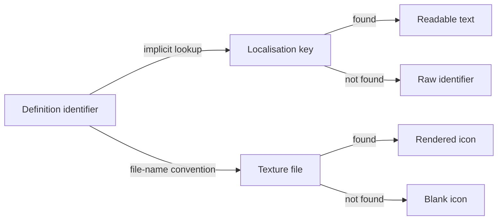

# Error handling

## Where failures originate

The mod contains no error-handling code, because it contains no code. Every failure is produced by an engine subsystem interpreting a mod file:

| Originator | Subsystem | Failure class |
|------------|-----------|---------------|
| Launcher mod loader | Descriptor parsing and version gate | Load-level rejection |
| Script parser | Deposits and technology files | Per-block rejection |
| Localisation loader | `l_english` tables | Key resolution failure |
| Texture loader | `gfx/interface/icons/` | Asset resolution failure |
| Save-game loader | Persisted planet state | Dangling reference on definition removal |

## Failure classes and their semantics

| Class | Detection point | Mod-visible signal | Player-visible outcome |
|-------|-----------------|--------------------|------------------------|
| Descriptor rejected | Launcher startup | None | Mod unavailable or flagged outdated |
| Malformed deposit block | Script parse | Game log may name the block | Blocker absent from play |
| Malformed technology block | Script parse | Game log may name the block | Technology absent from the tree |
| Unresolvable prerequisite | Clearing attempt | None | Blocker permanently unclearable |
| Undefined scripted variable | Script parse or evaluation | Game log may warn | Weight resolves unexpectedly |
| Missing localisation key | Display time | None | Raw identifier shown |
| Missing or misnamed texture | Display time | None | Blank icon |
| Vanilla identifier renamed | Parse or evaluation | Game log may warn | Conditional modifier silently inactive |
| Dangling saved blocker reference | Save load | None | Unverified — see [A8](ambiguities-and-open-questions.md) |

## Why silent failure is the norm

The engine resolves localisation keys and textures **by convention** rather than by an explicit declared path. There is nothing for the mod to assert and nothing for the engine to report back:

Every failure on the right-hand column is a degraded presentation rather than an error, so nothing is raised into a place the mod could observe.

## Mod-side strategy: prevention instead of recovery

Because recovery is impossible, the mod's error-handling strategy is the set of mechanical checks in [`testing.md`](testing.md):

| Risk | Mitigating check |
|------|------------------|
| Unlinked prerequisite | Prerequisite cross-check |
| Misnamed icon | Icon cross-check |
| Descriptor divergence | `diff` of the two descriptors |
| Missing localisation key | Manual key-set correlation |

These checks constitute the entire error-detection surface of the project.

## Degradation behaviour

| Degraded component | Does the rest survive? |
|--------------------|------------------------|
| One malformed deposit block | Yes — the other six blockers and all seven technologies remain functional |
| One malformed technology block | Partially — the matching blocker remains placeable but becomes unclearable |
| One missing localisation key | Yes — only that string is affected |
| One missing texture | Yes — only that icon is affected |
| One descriptor divergence | Depends on which channel read which file |
| One renamed vanilla identifier | Usually yes — the affected modifier becomes inert rather than fatal |

The parser is per-block, so a single syntax error does not remove the mod. This is the only resilience property the architecture provides, and it comes from the engine's design rather than from anything the mod does.

## Where to go next

- Diagnostic signals: [`logging.md`](logging.md)
- Checks: [`testing.md`](testing.md)
- Unverified failure modes: [`ambiguities-and-open-questions.md`](ambiguities-and-open-questions.md)
