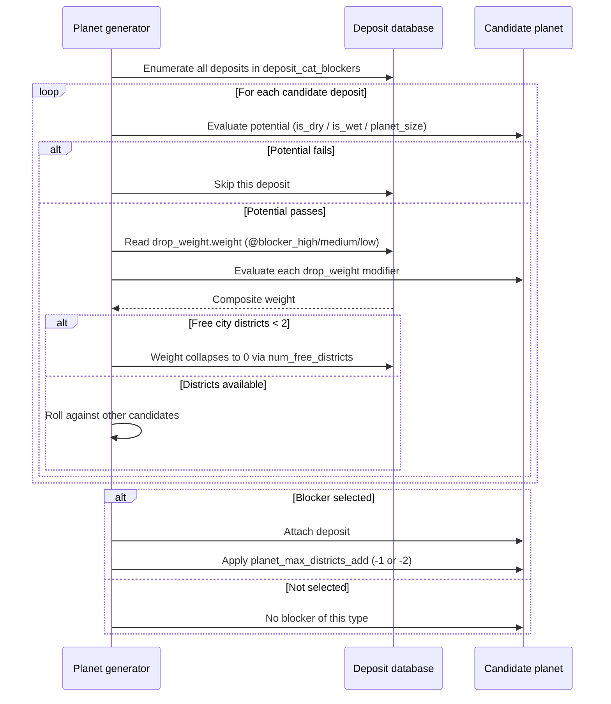

# Planet generation and blocker placement

## Scope

Describes how a planet acquires one of this mod's blockers, from the engine's candidate survey through the final district penalty. The mod supplies `potential` and `drop_weight`; the engine performs the survey, the roll, and the application.

## Sequence



## Evaluation order

1. **Candidate enumeration.** The engine collects deposits belonging to `deposit_cat_blockers`, which includes the mod's seven plus vanilla blockers.
2. **`potential` gate.** The deposit's `potential` block is evaluated against the planet. Failure removes the deposit from consideration entirely; no weight is computed.
3. **Baseline weight.** The `weight` value is read from the referenced scripted variable.
4. **Modifier application.** Each `modifier` inside `drop_weight` is applied. Modifiers are multiplicative, and any `factor = 0` collapses the result.
5. **Roll.** The engine selects among surviving candidates using their composite weights.
6. **Application.** The selected deposit is attached to the planet and its `planet_modifier` takes effect.

## `potential` variants and their effect

| Block | Planets admitted |
|-------|------------------|
| `{ is_dry = yes }` | Ashland, Canyon, Lava Lake, Tarland |
| `{ is_wet = yes }` | Floodplain |
| `{ AND = { is_dry = yes; planet_size >= 10 } }` | Giant Earthworms |
| `{ AND = { is_wet = yes; planet_size >= 10 } }` | Sea Monsters |

The two `-2` blockers additionally require `planet_size >= 10`, so a small dry or wet planet cannot receive the most damaging blocker.

## Composite weight composition

```text
composite = baseline × Π(modifier factors)
```

where `baseline ∈ {10, 7, 5}` and each modifier contributes a factor when its condition holds.

Worked example — Canyon on a size 20 arid planet with four free city districts:

```text
10 (baseline)
  × 1.0 (planet_size < 15 does not apply)
  × 2.0 (pc_arid matches the OR pair)
  × 1.0 (four free districts, guard does not apply)
= 20
```

Worked example — Canyon on a size 12 desert planet:

```text
10 (baseline)
  × 0.5 (planet_size < 15)
  × 1.0 (pc_desert is not in Canyon's pair: pc_arid / pc_savannah → no bonus)
= 5
```

Canyon favours arid and savannah, not desert, so a desert planet receives no class bonus. Lava Lake and Tarland, which do favour desert, would score `7 × 0.5 × 2 = 7` on the same planet instead.

## The universal guard

Every deposit ends its `drop_weight` with:

```
modifier = {
    factor = 0
    num_free_districts = {
        type = district_city
        value < 2
    }
}
```

Interpretation: if the planet has fewer than two free city districts, placement weight is zero. Because the factor is zero, the guard overrides every class bonus regardless of magnitude.

The guard exists because a blocker removes maximum districts; placing one on an already cramped planet would make colonisation impractical or impossible. See [D8](../design-decisions.md).

## Candidate interaction

| Interaction | Note |
|-------------|------|
| Mod blockers versus vanilla blockers | Both compete within `deposit_cat_blockers`; the mod's baselines (5–10) are modest by comparison with some vanilla weights |
| Lava Lake versus Tarland | Identical class modifiers and identical baseline, so they compete directly on desert and arid worlds |
| Multiple blockers on one planet | The engine decides how many blockers a planet receives; the mod does not constrain the count |
| Evaluation order among candidates | Engine-owned; see [A11](../ambiguities-and-open-questions.md) for the unanswered question about simultaneous evaluation against `num_free_districts` |

## `all_blocker_swap_types`

Five deposits declare `all_blocker_swap_types = yes`. Interpretation supported by the field name and by which deposits carry it: the engine may substitute an equivalent blocker type when the planet's class does not support the compact form. The two `-2` blockers omit it, and they are the only two that carry `on_cleared` effects — so a substitution would move a conditional effect onto a different blocker type, which the omission avoids.

## Persistence

Once attached, the blocker is written into the save game as part of the planet's state. Regenerating the galaxy or changing weights does not retroactively alter an existing planet. See [`../state-and-persistence.md`](../state-and-persistence.md).

## Where to go next

- Clearing flow: [`technology-research-and-blocker-clearing.md`](technology-research-and-blocker-clearing.md)
- Player-visible behaviour: [`../behaviour/blocker-appearance.md`](../behaviour/blocker-appearance.md)
- Weight values: [`../configuration.md`](../configuration.md)
