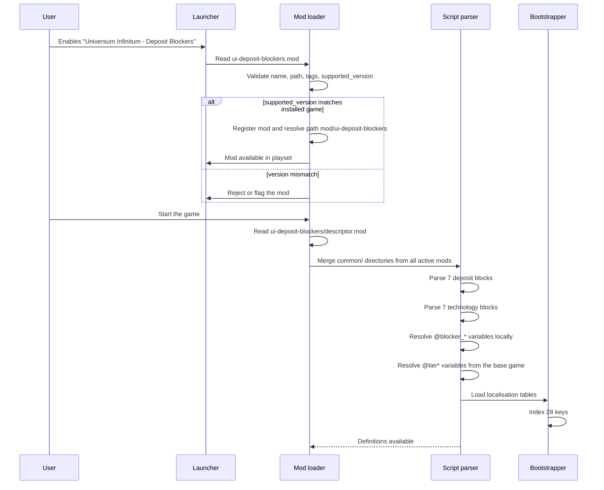

# Startup and loading

## Scope

Describes the sequence from launching the game to the mod's definitions being available in memory. All steps are engine- or launcher-owned; the mod contributes files only.

## Sequence

## Ordered steps

1. **Launcher reads the root descriptor.** `ui-deposit-blockers.mod` supplies `name`, `path`, `tags`, and `supported_version`. The `path` value `mod/ui-deposit-blockers` tells the loader where the content lives.
2. **Version gate.** The loader compares `supported_version="v4.5.*"` against the installed game version. A mismatch prevents the mod from loading correctly; this is the only hard failure the mod can experience outside parsing.
3. **In-directory descriptor read.** The engine reads `ui-deposit-blockers/descriptor.mod`, which is byte-identical to the root descriptor.
4. **Directory merge.** The engine collects `common/deposits/` and `common/technology/` from every active mod into shared namespaces. This is why every identifier carries the `ui` infix.
5. **Deposit parsing.** Seven deposit blocks are read. The three `@blocker_*` variables are resolved from the same file's header, which is why they must be declared before the first deposit block.
6. **Technology parsing.** Seven technology blocks are read, then the four vanilla `@tier*` variables are resolved from the base game's variable declarations.
7. **Localisation load.** The two `l_english` tables are indexed by key. Both files are read with their BOM intact.
8. **Textures are not loaded yet.** Icon files are resolved lazily when a blocker or technology is first displayed.

## Failure modes and their visibility

| Failure | When | Observable symptom |
|---------|------|--------------------|
| Descriptor rejected by version gate | Launcher | Mod absent from the playset or flagged as outdated |
| Wrong `path` | Launcher | Content directory not found |
| Deposit block malformed | Parse | Blocker absent from play with no in-mod error |
| Technology block malformed | Parse | Technology absent from the tree |
| Undefined `@blocker_*` variable | Parse | Deposit weight resolves unexpectedly |
| Undefined `@tier*` variable (vanilla change) | Parse | Technology cost or weight resolves unexpectedly |
| Localisation file unreadable (encoding) | Localisation load | Raw keys displayed |
| Icon file missing | First display | Blank or placeholder icon |
| Icon file misnamed | First display | Blank or placeholder icon |

The mod cannot report any of these. Detection relies on the cross-checks in [`../testing.md`](../testing.md) and on in-game observation.

## Reload semantics

| Change | Restart required |
|--------|------------------|
| Deposit or technology definition | Yes — scripts are parsed at startup |
| Localisation string | In practice yes; the engine reloads strings on locale change |
| Descriptor metadata | Yes — launcher reads it before startup |
| Icon file content | Yes — textures are cached for the session |

## Relationship to the parallel flow

Startup produces the parsed definitions that the placement flow consumes. Continue with [`planet-generation-and-blocker-placement.md`](planet-generation-and-blocker-placement.md).
