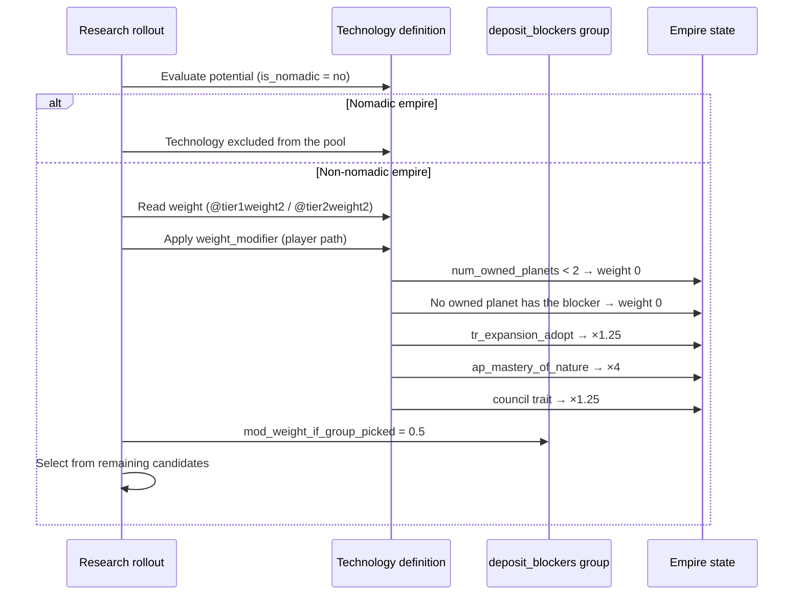
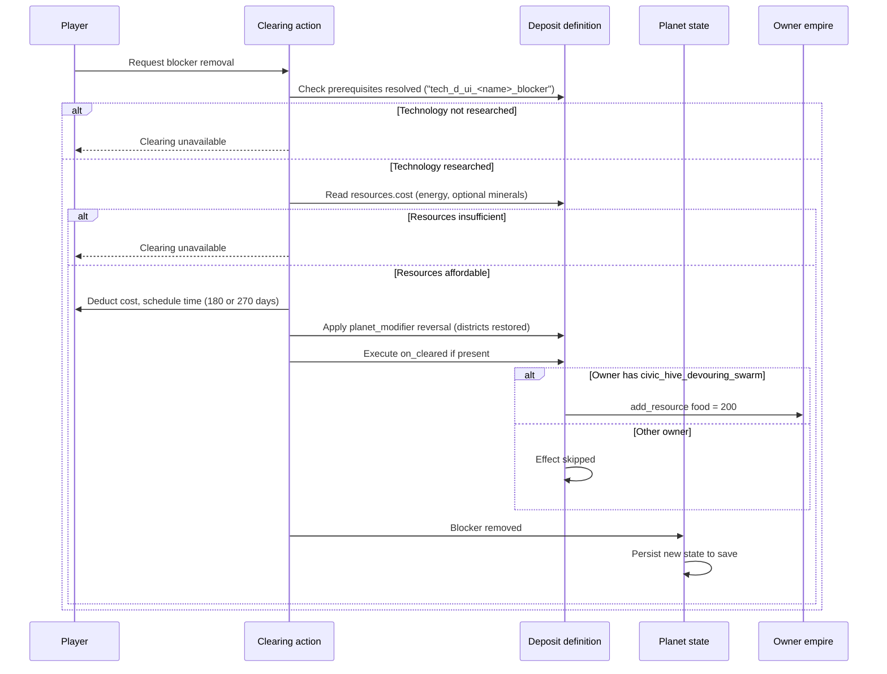

# Technology research and blocker clearing

## Scope

Describes the two engine processes the mod's technology definitions participate in: technology availability arbitration at each research rollout, and blocker clearing once the technology is researched. The clearing process also covers the `on_cleared` effect present on two blockers.

## Part 1: research availability



### Ordered steps

1. **`potential` gate.** An empire with `is_nomadic` never receives the technology, regardless of any other factor.
2. **Baseline weight.** Read from `@tier1weight2` or `@tier2weight2` depending on the tier.
3. **Suppression checks.** Two conditions collapse the weight to zero: the empire owning fewer than two planets, and no owned planet carrying the blocker. Both are present in the player and AI paths.
4. **Progression bonuses.** `tr_expansion_adopt` multiplies by `1.25`, `ap_mastery_of_nature` by `4`, and the council trait by `1.25`.
5. **Group decay.** Once any member of `deposit_blockers` has been researched, the remaining members are multiplied by `0.5`.
6. **Selection.** The engine picks from the surviving pool.

### Progressive weight behaviour

| Empire state | Effective weight |
|--------------|------------------|
| Owning one planet | 0 (early-game suppression) |
| Two or more planets, no blocker owned | 0 (no deposit check passes) |
| Two or more planets, blocker owned | `base × 2` |
| Plus expansion tradition adopted | `base × 2.5` |
| Plus nature mastery perk | `base × 10` |
| Plus new-worlds council trait | `base × 12.5` |
| Plus one family member already researched | halved by the group decay |

Because two independent conditions must pass before a technology can be offered, a technology appears abruptly in the pool the moment the empire both owns two planets and controls a planet carrying the matching blocker.

### Why a technology can appear and disappear

| Event | Effect |
|-------|--------|
| Empire conquers a second planet | Both suppression conditions become satisfiable |
| Empire acquires a planet with the blocker | Weight stops being zero |
| Empire loses every planet carrying the blocker | Weight returns to zero |
| Empire researches another family member | Remaining members halve |
| Empire adopts the nature mastery perk | Weight quadruples |

## Part 2: clearing a blocker



### Ordered steps

1. **Prerequisite check.** The blocker's `prerequisites` identifies the removal technology. Clearing is unavailable until that technology is researched.
2. **Cost check.** The declared `resources.cost` must be affordable. Only `energy` is required, with `minerals` additionally required for Tarland.
3. **Duration.** Clearing occupies the blocker's `time` value — 180 or 270 days.
4. **District restoration.** Clearing reverses `planet_modifier.planet_max_districts_add`, returning one district for a `-1` blocker and two for a `-2` blocker.
5. **`on_cleared` execution.** Only Giant Earthworms and Sea Monsters declare this block.
6. **Persistence.** The engine writes the new planet state into the save game.

### The `on_cleared` effect in detail

```
on_cleared = {
    hidden_effect = {
        if = {
            limit = {
                exists = owner
                owner = {
                    has_civic = civic_hive_devouring_swarm
                }
            }
            owner = {
                add_resource = {
                    food = 200
                }
            }
        }
    }
}
```

| Element | Effect |
|---------|--------|
| `hidden_effect` | The grant does not appear as a visible tooltip line |
| `exists = owner` | Guards against unowned planets where the `owner` scope would be invalid |
| `has_civic` | Restricts the grant to devouring swarms |
| `add_resource` | Grants `food = 200` once |

The grant is a one-time event tied to clearing, not a recurring modifier. Because it is `hidden_effect`, a player who clears the blocker has no explicit notification that the food was granted.

## Asymmetries between the two processes

| Aspect | Placement | Clearing |
|--------|-----------|----------|
| Gate type | `potential` (hard) plus weight modifiers | `prerequisites` (hard) plus resource cost (hard) |
| Reversibility | Blocker persists until cleared | Permanent once cleared |
| Retuning effect | New planets only | Immediate for subsequent attempts |
| Player control | None — placement is automatic | Full — the player chooses when and whether |

## Where to go next

- Player-visible behaviour: [`../behaviour/research-and-clearing.md`](../behaviour/research-and-clearing.md)
- Technology weights: [`../configuration.md`](../configuration.md)
- Save-state implications: [`../state-and-persistence.md`](../state-and-persistence.md)
