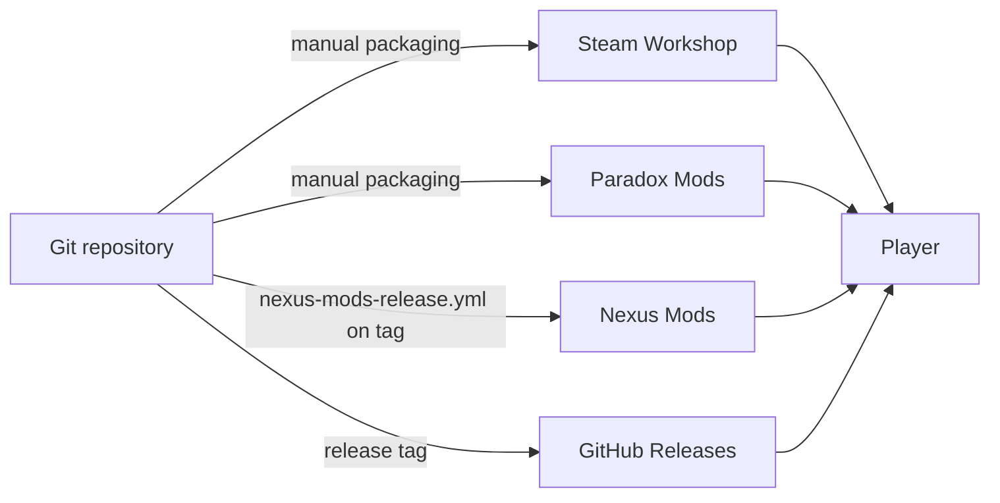

# Integrations

## Integration inventory

The mod has no built-in integrations of the conventional kind — no HTTP client, no database, no message broker, no authentication provider, and no third-party service. Its integrations are all engine- and platform-facing.

| Integration | Direction | Boundary | Contract | Failure semantics |
|-------------|-----------|----------|----------|-------------------|
| Stellaris launcher | Inbound | `.mod` descriptor | `name`, `path`, `tags`, `supported_version` | Mod rejected or flagged outdated |
| Script parser (deposits) | Inbound | `common/deposits/*.txt` | Deposit block schema | Per-block rejection; other blocks unaffected |
| Script parser (technology) | Inbound | `common/technology/*.txt` | Technology block schema | Per-block rejection |
| Localisation system | Inbound | `localisation/english/*.yml` | `l_english` key table with BOM | Raw identifier displayed |
| Texture loader | Inbound | `gfx/interface/icons/**` | File name equals identifier | Blank icon |
| Planet generator | Bidirectional | `potential`, `drop_weight` in; placement and district penalty out | Predicate and weight vocabulary | Blocker never placed |
| Technology system | Bidirectional | Weights and modifiers in; availability out | Vanilla variables and group semantics | Technology never offered |
| Clearing action | Bidirectional | `prerequisites`, `resources`, `time` in; district restoration and `on_cleared` out | Vanilla resource and effect vocabulary | Blocker unclearable |
| Save-game subsystem | Outbound (engine-owned) | Planet state | Persisted identifiers must resolve | Unverified on definition removal — see [A8](ambiguities-and-open-questions.md) |
| Steam Workshop | Delivery | Published item `2073660612` | Platform packaging | Stale snapshot |
| Paradox Mods | Delivery | Listing `34638` | Platform packaging | Stale snapshot |
| Nexus Mods | Delivery | Listing `91`, released file `955873` | Platform packaging; automated by `.github/workflows/nexus-mods-release.yml` | Upload failure leaves the channel unbumped |
| GitHub Releases | Delivery | Repository releases | Archive contents | Repository ahead of latest release |

## Engine integration in detail

### Planet generation

| Aspect | Value |
|--------|-------|
| Input the mod provides | `potential` gate, `drop_weight` baseline and modifiers |
| Output the engine produces | Deposit attachment and `planet_modifier` effect |
| Shared namespace | `deposit_cat_blockers`, shared with vanilla blockers |
| Coupling risk | The mod's candidates compete against vanilla blockers for the same planets |

### Technology system

| Aspect | Value |
|--------|-------|
| Input the mod provides | `cost`, `weight`, `weight_modifier`, `ai_weight`, `weight_groups` |
| Output the engine produces | Availability and research completion |
| Shared namespace | `new_worlds` category; `deposit_blockers` weight group |
| Coupling risk | Any other mod joining `deposit_blockers` would compete in the same group |

### Clearing

| Aspect | Value |
|--------|-------|
| Input the mod provides | `prerequisites`, `resources.cost`, `time`, `planet_modifier`, `on_cleared` |
| Output the engine produces | Cost deduction, duration, restoration, effect execution |
| Shared namespace | `deposit_blockers` resource category (Ashland only) |
| Coupling risk | Vanilla resource and civic identifiers must resolve |

## Vanilla identifiers as an integration contract

The mod integrates with the base game through a defined set of vanilla identifiers. Each is a contract; [`dependencies.md`](dependencies.md) enumerates them in full.

| Vanilla identifier | Contract |
|--------------------|----------|
| `tech_colonization_1` | Must exist; gates all seven technologies |
| `new_worlds` | Must exist; positions the technologies in the society tree |
| `deposit_cat_blockers` | Must exist; makes deposits behave as blockers |
| `tr_expansion_adopt`, `ap_mastery_of_nature`, `leader_trait_expertise_new_worlds` | Must exist; selected modifiers become inert otherwise |
| `civic_hive_devouring_swarm` | Must exist; gates the `on_cleared` grant |
| `pc_nuked`, `pc_alpine`, `pc_arid`, `pc_savannah`, `pc_ocean`, `pc_continental`, `pc_desert` | Must exist; class modifiers become inert otherwise |
| `@tier1cost2`, `@tier1weight2`, `@tier2cost2`, `@tier2weight2` | Must exist; technology cost and weight depend on them |

## Mod-to-mod integration

**None.** No sibling Universum Infinitum mod is a dependency, and no shared file is consumed. The `README.md` collection listing is discoverability information, not an integration.

Two scenarios could create an unintended integration:

1. Another mod defining an identifier with the same name — mitigated by the `ui` infix.
2. Another mod joining the `deposit_blockers` weight group — this would change selection competition across both mods.

Neither has been reported, and neither has been ruled out by survey — see [A10](ambiguities-and-open-questions.md).

## Distribution platform integration

Each channel holds its own copy. Only the Nexus Mods upload is automated, and it consumes the archive already attached to the GitHub release; the remaining channels are updated by hand, so a change must still be published everywhere to avoid drift. Because the newest release tag predates the most recent repository commits, players using a channel that hosts the tagged archive receive older content than the repository contains.

## Where to go next

- Dependency detail: [`dependencies.md`](dependencies.md)
- Engine integration model: [`architecture.md`](architecture.md)
- Delivery procedure: [`build-and-deployment.md`](build-and-deployment.md)
