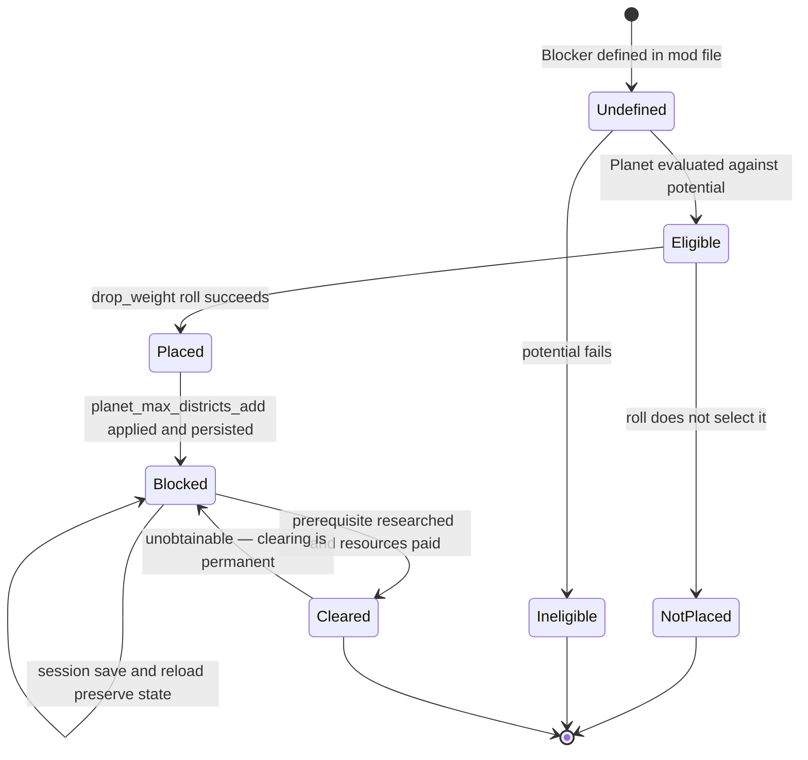

# State and persistence

## Ownership summary

The mod owns **no runtime state** and performs **no persistence**. It declares definitions; the engine derives state from them and persists that state in the save game.

| State | Owner | Representation | Lifetime |
|-------|-------|----------------|----------|
| Deposit definitions | Mod files | Static script | Re-parsed each session |
| Technology definitions | Mod files | Static script | Re-parsed each session |
| Scripted weight baselines | Mod files | Static script | Re-parsed each session |
| Localisation strings | Mod files | Static tables | Session, reloaded on locale change |
| Textures | Mod files | DDS assets | Session |
| Which blocker each planet carries | Engine | Save-game planet state | Campaign |
| Which blockers have been cleared | Engine | Save-game planet state | Campaign |
| Which removal technologies an empire has researched | Engine | Save-game empire state | Campaign |

## The state lifecycle

Two properties follow:

1. **Placement is decided once**, at planet-generation time. Editing a `potential` or `drop_weight` cannot retroactively change an existing planet.
2. **Clearing is irreversible** in the current design. No definition re-adds a cleared blocker, and no engine behaviour restores one.

## What persists where

| Persisted datum | Written by | Read by |
|-----------------|-----------|---------|
| Planet's deposit list | Engine, on generation and on clearing | Engine, for tooltips, district accounting, and prerequisite checks |
| Planet's maximum district count | Engine, from `planet_modifier` | Engine, for colonisation and district construction |
| Empire's researched technology set | Engine, on research completion | Engine, for the clearing prerequisite check |
| Nothing of the above | The mod | The mod |

## Definition changes and their effect on existing state

| Change | Effect on an in-progress campaign |
|--------|-----------------------------------|
| Add a blocker | No effect on existing planets; new planets may receive it |
| Remove a blocker | Planets already carrying it hold a reference to an undefined definition — behaviour unverified, see [A8](ambiguities-and-open-questions.md) |
| Rename an identifier | Equivalent to removing the old identifier and adding a new one |
| Retune `drop_weight` or `potential` | No effect on existing planets |
| Retune `resources.cost` or `time` | Immediate effect on subsequent clearing attempts |
| Retune technology `weight` or `weight_modifier` | Effect on subsequent research rollouts |
| Change localisation text | Immediate for all blockers sharing the identifier |
| Change the `on_cleared` effect | Applies to blockers cleared after the change |
| Change `supported_version` outside the installed game family | Mod may fail to load entirely |

## Migration

There is no migration mechanism, no save-game versioning, no repair routine, and no compatibility shim. Consequences:

- Blocker removal is the only repository edit with a plausible campaign-level impact, and its outcome is unverified.
- Adding content is safe for existing saves because nothing already placed changes.
- Retuning is safe but non-retroactive for placement.

A conservative practice for removal is to leave the definition in place with `potential = { always = no }` rather than deleting the block, so existing saves retain a resolvable reference while new planets cannot receive the blocker. **This is a recommendation derived from the unverified risk in [A8](ambiguities-and-open-questions.md), not a documented project practice.**

## Persistence-related invariants

| Invariant | Statement |
|-----------|-----------|
| No mod-side I/O | The mod reads and writes nothing at runtime |
| No mod-side migration | No versioning or repair logic exists |
| Non-retroactive placement | Definition edits never alter existing planets |
| Irreversible clearing | No definition re-adds a cleared blocker |

## Where to go next

- Placement lifecycle: [`flows/planet-generation-and-blocker-placement.md`](flows/planet-generation-and-blocker-placement.md)
- Clearing lifecycle: [`flows/technology-research-and-blocker-clearing.md`](flows/technology-research-and-blocker-clearing.md)
- Removal risk: [`ambiguities-and-open-questions.md`](ambiguities-and-open-questions.md) A8
